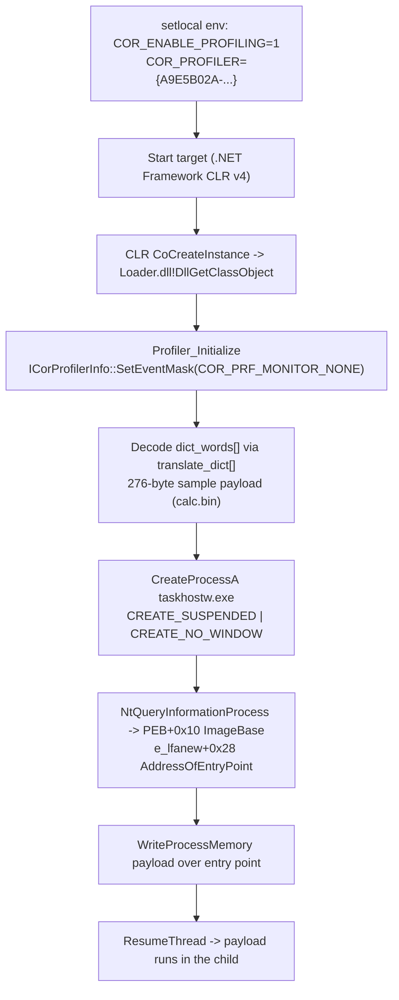

# CLR Profiler Injection-Chain PoC

Lab PoC for the LoaderVille injection-chain validation. A COM profiler DLL
(`Loader.dll`) is loaded into a .NET Framework CLR v4 process through the
supported `COR_*` profiling environment variables. On
`ICorProfilerCallback3::Initialize` it runs a full injection chain:



The profiler DLL itself never executes the payload; the payload runs in the
spawned `taskhostw.exe` child. The sample `calc.bin` pops `calc.exe` as the
observable success signal.

## Pipeline

```text
calc.bin (raw shellcode) + static/english-words.txt
        |
        v  DictionShellcode.py (dictionary substitution encode)
TemplateClrProfiler.c  --->  ClrProfiler/ClrProfiler.c  (generated)
        |
        v  MSVC v145 x64, Release
bin/x64/Release/Loader.dll
```

`ClrProfiler.c` is **generated**. Do not hand-edit it — change
`TemplateClrProfiler.c` (logic) or the shellcode input, then regenerate.

## Payload encoding

Each payload byte $0x00..0xFF$ maps to one unique word of a 256-word
dictionary sampled from `scripts/english-words.txt` (no duplicate lines in the
list, so the reverse map is unambiguous):

- `dict_words[N]` — the payload as words, `N` = payload byte length
  (`SHC_LEN`; 276 for `calc.bin`);
- `translate_dict[256]` — word for each byte value.

At runtime `Initialize` reverse-maps every word to its byte with a strcmp
scan (O(N·256), fine for small blobs). This only lowers static entropy of the
stored blob; it is not encryption.

## Entry-point patch

The child is created suspended with a command line mimicking a legitimate
taskhostw task-host invocation. The chain then:

1. resolves `NtQueryInformationProcess` from `ntdll` and reads
   `PROCESS_BASIC_INFORMATION.PebBaseAddress`;
2. reads `ImageBaseAddress` at `PEB+0x10` and the first `0x200` PE header
   bytes;
3. computes `AddressOfEntryPoint = *(DWORD*)(headers + e_lfanew + 0x28)`;
4. `WriteProcessMemory`s the decoded payload over
   `ImageBase + AddressOfEntryPoint` and resumes the initial thread.

No new thread, no allocation of executable memory in the target — the payload
is executed in place of the child's own entry code. The payload must be
position-independent and there is no size check against the entry region.

## Files

| File | Role |
|---|---|
| `ClrProfiler/ClrProfiler.c` | Generated profiler source compiled into `Loader.dll` |
| `ClrProfiler/TemplateClrProfiler.c` | Template with `$__ENCRYPTED_SHELLCODE__$` / `$__DICT__$` markers |
| `ClrProfiler.def` | Exports `DllGetClassObject`, `DllCanUnloadNow` (PRIVATE); library name `Loader` |
| `scripts/DictionShellcode.py` | Dictionary encoder (run from `net_profiler_hijack/`) |
| `scripts/english-words.txt` | Word list for the 256-entry dictionary |

## Build

From `net_profiler_hijack/` (the encoder reads `static/english-words.txt`
relative to the working directory):

```bat
python3 DictionShellcode.py -f shellcode.bin -l c -t ClrProfiler\TemplateClrProfiler.c -o ClrProfiler\ClrProfiler.c
```

Then open `ClrProfiler.sln`, select **Release | x64**, **Build > Build
Solution** (or `msbuild ClrProfiler.sln /p:Configuration=Release /p:Platform=x64`)
and confirm:

```text
bin\x64\Release\Loader.dll
```

Notes:

- The encoder samples its dictionary with unseeded `random.sample`, so every
  regeneration produces a different word mapping and a different
  `ClrProfiler.c`. Rebuild the DLL after regenerating.
- To swap the payload, pass another raw shellcode file to `-f`. The payload
  must be position-independent shellcode.

## Run

The profiler CLSID `{A9E5B02A-48D6-4F3E-9D1A-7C06D5F4C8B1}` is fixed in both
the DLL and the launcher environment — change it in both or neither.

```bat
setlocal
set COR_ENABLE_PROFILING=1
set COR_PROFILER={A9E5B02A-48D6-4F3E-9D1A-7C06D5F4C8B1}
set COR_PROFILER_PATH_64=C:\path\to\bin\x64\Release\Loader.dll
"KeePass.exe"
```
