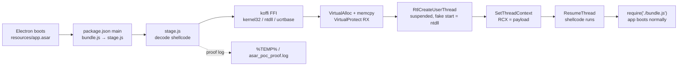

# Electron `app.asar` Backdoor PoC

Proof-of-concept: persistently patch an Electron application's `app.asar`
(e.g. Discord on Windows) so that arbitrary shellcode executes in the app's
process on every launch — while the app itself boots and behaves normally.
Fully reversible.

**PoC only.** Run it solely on systems you own or are explicitly authorized to
test. The payload is a benign `calc.exe` launcher; nothing else.

## What it demonstrates

1. **Supply-chain-free local persistence via a by-design load surface.**
   Electron apps ship their entire JS in `resources/app.asar`, and
   `package.json`'s `main` field decides what loads first. Repointing
   `main` (`bundle.js` → `stage.js`) gives code execution inside the trusted
   app process. No binary patching, no signature bypass.
2. **Native code execution from plain JS via FFI.** The stage vendors
   [koffi](https://koffi.dev/) (a Node-API FFI bridge) into the archive.
   Its `.node` ships either packed inside `app.asar` (Electron extracts it to
   `%TEMP%` on first `require`) or in `app.asar.unpacked`
   (`KOFFI_UNPACK=1`).
3. **Thread-start-address spoofing for the shellcode launch.** A suspended
   thread is created with a legitimate ntdll start routine
   (`RtlClearThreadWorkOnBehalfTicket`) as its entry point, then
   `Get/SetThreadContext` rewrites `RCX` to the RWX→RX payload before
   `ResumeThread`. The thread's recorded start address never points at the
   allocated shellcode.
4. **Stealthy chaining.** `stage.js` finishes with
   `module.exports = require('./bundle.js')`, so the real application
   bootstrapper runs unchanged and the user sees nothing.

## Execution chain



## Layout

| Path | Role |
|---|---|
| `deploy.sh` | Extract target `app.asar`, patch, validate, back up, install |
| `restore.sh` | Undo: restore `app.asar.orig.bak`, remove koffi leftovers |
| `tools/patch.js` | Core transform: inject payload, repack, verify (file-list diff, hashes) |
| `payload/stage.js` | Stage-2: koffi loader + thread-spoof shellcode launch + chain to `bundle.js` |
| `payload/shellcode.js` | Base64 shellcode blob (currently a `calc.exe` launcher) |

## Prerequisites

- WSL2 (paths below assume the `/mnt/c/...` layout), Node.js ≥ 18
- `npm install` in this directory (pulls `@electron/asar`, `koffi`)
- Target app must be **closed** before deploying (the archive is rewritten in place)
- Windows x64 target; the `CONTEXT` offsets in `stage.js` are AMD64

## Usage

```sh
npm install

# Deploy (glob is expanded here; newest match wins)
./deploy.sh '/mnt/c/Users/*/AppData/Local/Discord/app-*/resources/app.asar'

# Launch the target app normally, then check the proof
cat /mnt/c/Users/*/AppData/Local/Temp/asar_poc_proof.log

# Undo
./restore.sh '/mnt/c/Users/*/AppData/Local/Discord/app-*/resources'
```

Proof log lines: `koffi : loaded (napi …)`,
`thread : fake start 0x… -> entry 0x…`,
`[timestamp] payload running on spoofed thread`. Any failure lands in the same
log (`loader error: …`) instead of breaking the app — the chain to
`bundle.js` runs regardless.

## Build/verify details

`tools/patch.js` rebuilds the patched archive from the **target's own**
`app.asar` every run (never from a stale artifact) and then:

- diffs the packed file list against the original — only `stage.js`,
  `shellcode.js`, and `node_modules/` (koffi) may be added; nothing removed;
- extracts `koffi.node` from the packed result and checks its SHA-256 against
  the installed source;
- prints `main` before/after, added/removed files, and both archive hashes.

`deploy.sh` additionally creates a one-time `app.asar.orig.bak` next to the
target and reports SHA-256 of installed vs. patched archive. Packed-mode
archives carry the `.node` inside `app.asar` (Electron extracts it to
`%TEMP%` on first `require`); `KOFFI_UNPACK=1 node tools/patch.js …` instead
ships it in `app.asar.unpacked`, which `deploy.sh` merges and `restore.sh`
cleans up.

